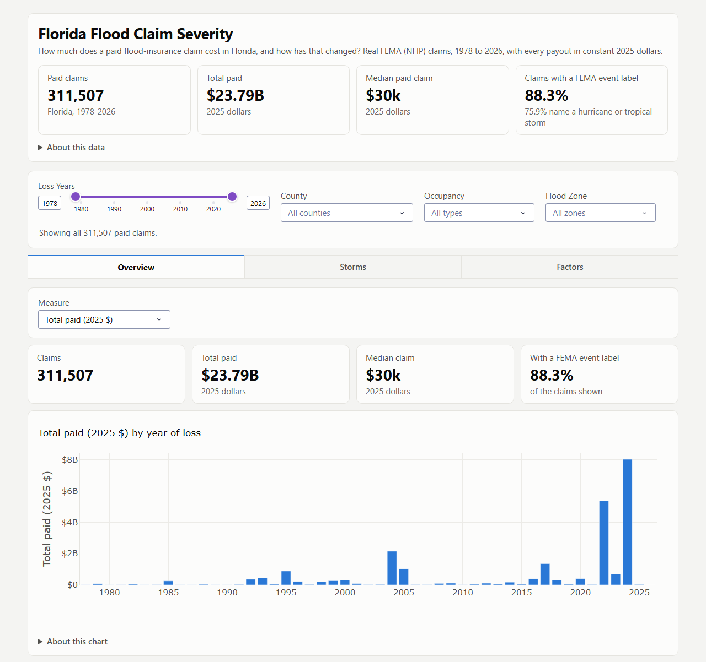

# Florida Flood Claim Severity



https://florida-flood-claim-severity.onrender.com/

An interactive dashboard of what Florida's federal flood-insurance claims have paid since 1978, and which building and location factors go with larger payouts. Every payout is in constant 2025 dollars, so a 1992 claim and a 2024 claim can be compared.

## Headline

In 2025 dollars, the median paid claim rose from about $4,800 in 1978-79 (4,077 claims) to about $78,000 in 2020-26 (124,593 claims). The 2020s include the Ian, Helene and Milton seasons; without those three storms' claims the 2020s median is about $42,500, still about 51% above the 2010s median of about $28,000. The figures cover claims that were paid, and about 30% of claims were closed without payment.

## Who's this for?

Analysts, home buyers, and realtors

## What can it do?

It can answer: how many flood claims did the federal program pay in Lee County between 1990 and 2000 for single-family homes? How much did they cost?

## How to use it?

Set the filters at the top (**Loss Years, County, Occupancy, Flood Zone**) and the **Overview**, **Storms** and **Factors** tabs update together. Every chart and table shows the number of claims behind it.

## Data

| Source | What |
|---|---|
| [OpenFEMA NFIP Redacted Claims, v3](https://www.fema.gov/openfema-data-page/nfip-redacted-claims-v3) | 448,618 Florida claims, pulled 2026-11-03 (FEMA last refreshed the dataset on 2026-09-09). NFIP is the National Flood Insurance Program, run by FEMA, the Federal Emergency Management Agency. |
| [FRED CPIAUCSL](https://fred.stlouisfed.org/series/CPIAUCSL) | CPI-U (Consumer Price Index for All Urban Consumers), for the inflation adjustment to 2025 dollars. |

Payout is the building, contents and increased-cost-of-compliance payments added together. After cleaning, the dashboard covers 311,507 paid claims totaling $23.79 billion. 88.3% of them carry a FEMA event label, and 75.9% name a hurricane or tropical storm.

## Reading the numbers

- **Locations.** FEMA blurs coordinates to 0.1 degree (about 7 miles), so a point can fall in the wrong county; the county field is the reliable location.
- **Years.** A year is the year of loss, when the flood happened, not the year the claim was paid.
- **Fields recorded for part of the claims.** Foundation type, elevation, deductible and water depth are "Not recorded" for different shares of each decade; foundation type, for example, is recorded for 97% of 2020-26 claims and almost none before 2000.
- **Building age and loss year move together.** The median building age at loss was 15 years in the 1980s, 38 in the 2010s and 50 in the 2020s, so larger payouts among older buildings may reflect when the claim happened.
- **Event labels.** Storm names are FEMA's own labels, but how consistently claims were labeled varies by decade (55% of 1978-79 claims carry a label, 97.5% of 2020-26 claims), so a claim without a label can still be storm-related.

[docs/METHODOLOGY.md](docs/METHODOLOGY.md) lists every cleaning step with its counts and how each factor is grouped.

## Run it

Requires Python 3.13 or newer (the hosted dashboard runs on 3.14).

```bash
pip install -r requirements.txt

python fetch_data.py         # download and cache the raw data into data/raw/ (gitignored)
python build_dataset.py      # clean, inflation-adjust, group and label the claims
python build_deploy_data.py  # compact bundle for the app -> deploy_data/
python app.py                # dashboard at http://localhost:8058
```

`deploy_data/` is committed, so the dashboard runs without any of the steps above. The hosted dashboard runs on Render with `wsgi.py` as its entry point; `render.yaml` records the service's settings for reference, and Render's dashboard controls the live service.

## Tests

About 70 tests run in under half a minute with no network access, and on every push through GitHub Actions (Python 3.13 and 3.14). They check the cleaning counts and the payout sum, the inflation adjustment, the event labels, the grouping of every factor, the consistency of the committed `deploy_data/`, and that every dashboard callback returns, including when a filter matches no claims.

```bash
pip install -r requirements.txt -r requirements-dev.txt
python -m pytest
```

## Files

| File | Purpose |
|---|---|
| `fetch_data.py` | Download and cache FEMA claims and CPI-U |
| `build_dataset.py` | Cleaning, inflation adjustment, grouping, event labels, validation |
| `build_deploy_data.py` | Packages the claims table and the headline numbers into `deploy_data/` |
| `constants.py` | Category labels, FEMA code definitions and thresholds shared by the pipeline and the app |
| `app.py`, `wsgi.py` | The Dash dashboard and its hosting entry point |
| `render.yaml`, `requirements-render.txt` | The hosted service's settings (for reference) and the hosted app's dependencies |
| `requirements.txt`, `requirements-dev.txt` | Dependencies for the pipeline and app, and for the tests |
| `tests/`, `pytest.ini`, `.github/workflows/tests.yml` | The test suite and the workflow that runs it |
| `deploy_data/` | What the hosted app loads |
| `docs/METHODOLOGY.md` | Sources, cleaning, grouping, reproducibility |

Released under the MIT License.
